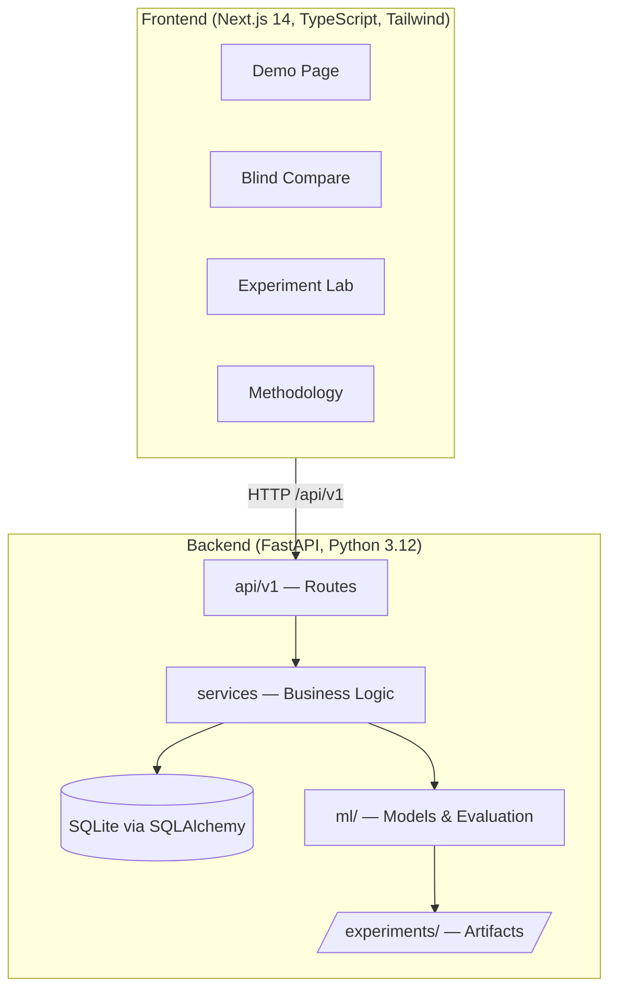

# Movie Recommendation System + Experiment Lab

> **Research question:** Can a personalized recommendation system improve recommendation accuracy
> and user satisfaction compared with a non-personalized system?

Academic project — *Research Methodologies and Experimental Design, CSE-A.*

---

## What it is

A production-grade implementation of a movie recommendation study with two products:

1. **Recommender Demo** — Choose a demo user, rate movies, get recommendations from any model with "Because you liked X" explanations, give feedback.
2. **Experiment Lab** — Run the study: train all models under identical conditions, compute metrics, compare results in tables and charts, export artifacts.

**Every number shown in the UI comes from an experiment run stored on disk. No values are fabricated or hard-coded.**

---

## Quickstart (5 commands)

```bash
# 1. Clone
git clone <this-repo> && cd movie-rec

# 2. Install dependencies
make setup

# 3. Download MovieLens ml-latest-small (~6 MB)
make data

# 4. Start dev servers (backend :8000, frontend :3000)
make dev

# 5. (Optional) Run a full experiment
make experiment
```

Open `http://localhost:3000` in your browser.
API docs: `http://localhost:8000/docs`

---

## Architecture



**Layer rule:** `api` → `services` → (`repositories` | `ml`). ML code never imports from `app` or `db`.

---

## Models

| Model | Type | Notes |
|---|---|---|
| PopularityBaseline | Non-personalized | Bayesian damped mean — control group |
| UserKNN | Collaborative filtering | User-based cosine KNN |
| ItemKNN | Collaborative filtering | Item-based adjusted-cosine KNN |
| MatrixFactorization | Collaborative filtering | SVD-style via NumPy/SciPy |
| ContentBased | Content-based | TF-IDF genres → cosine profile matching |
| Hybrid | Hybrid | Weighted CF + CB, alpha tuned on val split |

---

## Reproducing an experiment

```bash
make reproduce RUN=<experiment-id>
# Example: make reproduce RUN=20241004_120000_abc123
```

This re-runs the experiment from its `config.json` and verifies metrics match within tolerance.

---

## Running tests

```bash
make test         # backend (pytest) + frontend (vitest)
make lint         # ruff + mypy + eslint + tsc
```

---

## Dataset

**MovieLens ml-latest-small** — ~100k ratings, ~9k movies, ~600 users.
Downloaded by `scripts/download_data.py`. **Not committed to this repository.**

> Citation: F. Maxwell Harper and Joseph A. Konstan. 2015. The MovieLens Datasets: History and Context.
> ACM Transactions on Interactive Intelligent Systems, 5(4): 19:1–19:19. https://doi.org/10.1145/2827872

License: [GroupLens Terms of Use](https://grouplens.org/datasets/movielens/)

---

## Documentation

| File | Contents |
|---|---|
| `docs/DECISIONS.md` | All architectural decisions with reasons and alternatives |
| `docs/methodology.md` | Full study design (variables, controls, validity, ethics) |
| `docs/ETHICS.md` | Privacy and ethics commitments |
| `docs/RESULTS_TEMPLATE.md` | Report skeleton auto-filled from experiment artifacts |
| `docs/DEPLOY.md` | Deployment guide (single VM or managed container) |

---

## Performance targets (measured after Phase 6)

| Metric | Target |
|---|---|
| Single recommendation request (warm) | < 200 ms |
| Full model training (all models, laptop CPU) | < 5 minutes |
| Frontend Lighthouse performance | ≥ 90 |
| Frontend Lighthouse accessibility | ≥ 90 |

---

## Out of scope

Real user accounts/auth, payments, video streaming, GPU models, multi-language UI,
mobile apps, production cloud deployment, scraping, any dataset other than MovieLens ml-latest-small.
